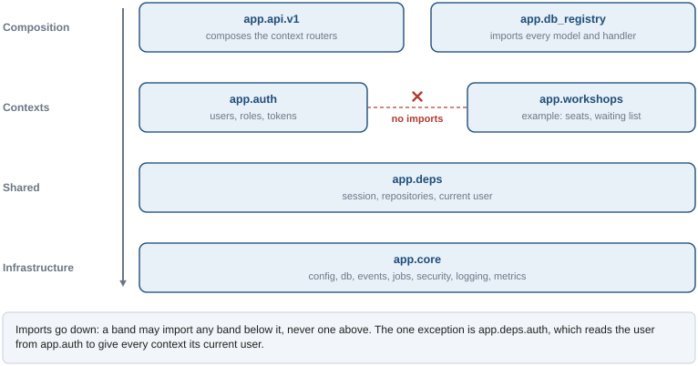
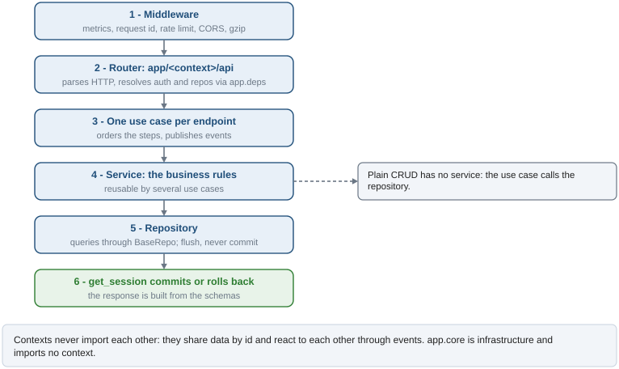

# Architecture

Code is grouped by what it is about (a bounded context: `auth`, `items`), and inside each
context by layer. A new feature touches one folder; the rules for what may import what are
written down and checked, so the structure does not erode as the project grows.

## Layout

```
app/
  core/            infrastructure: config, db (Base, mixins), repo.py (BaseRepo), schema.py,
                   security, events (bus, worker, outbox model), jobs (worker, model, heartbeat),
                   logging, metrics, middleware, rate limiting, exceptions, lifespan
  deps/            FastAPI dependencies shared by every context (session, repos, current user)
  api/v1/          composes the context routers, plus health and metrics
  auth/            context: users, roles, permissions, tokens
    models/ schemas/ repos/ services/ use_cases/ api/ jobs/
  items/           context: the example CRUD
    models/ schemas/ repos/ use_cases/ api/ event_handlers/
  db_registry.py   imports every model and handler module (see below)
```

The packages form bands, and imports only go down them.



Items gets the current user from `app.deps.auth`, never by importing `app.auth`; items and users
are linked by `owner_id` only, without an ORM relationship across contexts.

## How a request flows

The figure follows a request from the middleware to the commit.



| Layer | Does | Does not |
|---|---|---|
| `api/` | Parse HTTP, resolve dependencies, call **one** use case, return schemas | Business rules, queries |
| `use_cases/` | Orchestrate: order of steps, which services, own transactions when needed, events | Business rules |
| `services/` | Business rules, reusable by several use cases | FastAPI imports, `HTTPException` |
| `repos/` | Queries through `BaseRepo[T]`; `flush`, never `commit` | Business rules |
| `models/` | ORM tables | Queries, logic |
| `schemas/` | Request and response shapes | Logic, database access |

**Use cases orchestrate services; services hold the business rules.** A plain CRUD use case may
call the repository directly (see `app/items/use_cases/`); as soon as a rule appears, it goes
into a service. Errors are domain exceptions (`app/core/exceptions`), turned into HTTP responses
by global handlers.

## Rules and how they are enforced

| Rule | Enforced by |
|---|---|
| Inside a context, a layer imports only the layers below it | `.importlinter`, contract `layers` |
| `app.core` imports no context, `app.deps`, `app.api` or the registry | `.importlinter`, contract `core` |
| Contexts do not import each other | `.importlinter`, contracts `items-auth`, `auth-items` |
| An endpoint runs at most one use case | `tests/unit/test_api_endpoint_single_use_case.py` |
| The models match the migrations | `tests/integration/test_migrations.py` |

`uv run lint-imports` runs the contracts; CI runs it on every PR. A justified exception goes in
`ignore_imports` with a comment; several of the same kind mean the rule needs revisiting.

## The registry

Models must be imported for `Base.metadata` to know their tables, and event and job handlers
must be imported for their decorators to register them. `app/db_registry.py` imports all of
them, and `main.py`, `migrations/env.py` and the integration tests import the registry. It sits
outside `app/core` because it imports the contexts. A handler module that is not listed there
never runs: the event bus then retries its events until they fail (see `docs/event-bus.md`).

## Adding a context

1. `app/<context>/` with the layers it needs (`models/ schemas/ repos/ services/ use_cases/
   api/`, plus `event_handlers/` or `jobs/`), each with an `__init__.py`.
2. Models on `app.core.db.Base` with `IntPkMixin`/`AuditMixin`; repositories on `BaseRepo[T]`.
3. Router in `app/<context>/api/router.py`, included in `app/api/v1/__init__.py`.
4. Imports of its models and handlers in `app/db_registry.py`.
5. The context in the `containers` of the `layers` contract, and `forbidden` contracts against
   the other contexts, in `.importlinter`.
6. A migration (`docs/migrations.md`) and tests in `tests/{unit,functional,integration}/<context>/`.
7. A doc in `docs/` if it brings a new piece of infrastructure or a non-obvious flow.

To add a feature to an existing context, add files to its layers; nothing outside the context
changes except the registry, the router composition or the migrations.

## Cross-cutting pieces

- **Event bus**: transactional outbox with LISTEN/NOTIFY. See `docs/event-bus.md`.
- **Scheduled jobs**: rows claimed with a lease. See `docs/jobs.md`.
- **Auth**: rotated refresh tokens, revocation, roles and permissions. See `docs/auth.md`.
- **Database and migrations**: `docs/database.md`, `docs/migrations.md`.
- **Logging, metrics**: `docs/logging.md`, `docs/metrics.md`. Log lines carry the layer and
  module taken from the logger name (`app.items.api.router` logs as `[Router] [Items]`).
- **Configuration, tooling, Docker**: `docs/configuration.md`, `docs/tooling.md`, `docs/docker.md`.

Decisions behind this layout: [ADR-003](adr/003-bounded-contexts.md).
