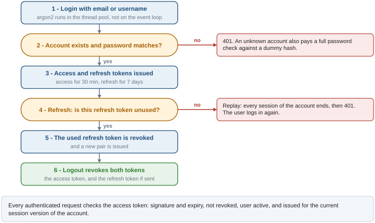
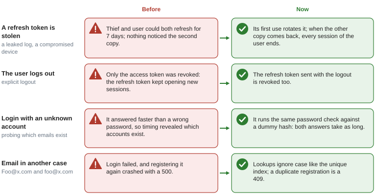

# Authentication and authorization

## What it solves

The API authenticates users with short-lived JWT access tokens and longer-lived refresh tokens,
without server-side sessions. On top of plain JWTs it adds what stateless tokens lack on their
own: revocation on logout, detection of stolen refresh tokens, a way to end every session of an
account, and role/permission checks.

## How a session lives

A session starts at login, renews itself with refresh tokens and ends at logout or when a stolen
token is detected. The figure follows one session through those steps.



1. **Login** `POST /v1/auth/login` (OAuth2 form, `application/x-www-form-urlencoded`) with an
   email or username and the password. Returns an access token and a refresh token.
2. **Use** `Authorization: Bearer <access_token>` on protected endpoints. The `get_current_user`
   dependency (`app/deps/auth.py`) checks on every request that the token is valid, of type
   `access`, not revoked, that the user exists and is active, and that the token was issued after
   the account's last invalidation.
3. **Refresh** `POST /v1/auth/refresh` with `{"refresh_token": ...}`. The refresh token is
   *rotated*: it is revoked and a new pair is returned. Each refresh token works once.
4. **Logout** `POST /v1/auth/logout` with the access token in the header and, optionally,
   `{"refresh_token": ...}` in the body. Revokes both; send the refresh token or it stays valid
   until it expires.

Other endpoints: `POST /v1/auth/register` (email validated with `EmailStr`, password of at least
8 characters) and `GET /v1/auth/me`.

## Stolen tokens and other attacks

Rotation turns a stolen refresh token into something detectable: after a rotation, only the
legitimate client or a thief can still present the old token, and both cannot keep using it. The
figure compares the old behavior with the current one for this and three other cases.



- **Reuse detection.** `RevokedTokenRepo.revoke` is a single `INSERT ... ON CONFLICT DO NOTHING`,
  so of two requests presenting the same refresh token only one revokes it. The other raises
  `RefreshTokenReuseError`, and `RefreshTokenUseCase` sets `users.tokens_valid_after = now()` in
  a transaction of its own: the request ends in 401 and `get_session` rolls its own transaction
  back, which would otherwise undo the countermeasure. From then on every token with an older
  `iat` is rejected, the thief's and the user's alike; the user logs in again.
- **Second precision.** `iat` is an integer, so the cut-off is truncated to the second: a login
  right after the invalidation must not be rejected. The flip side: a token issued in the same
  second as the invalidation (for example by the refresh that preceded the replay) stays valid
  until it expires.
- **Timing.** A login for an unknown account verifies the password against a dummy argon2 hash,
  so it takes as long as a wrong password and does not reveal which accounts exist.
- **Case.** Email and username lookups use `LOWER(...)`, like the unique indexes.

Two legitimate clients sharing one refresh token (two tabs refreshing at once) look like a replay
and end the session. Clients should serialize refreshes.

## JWT structure

| Claim | Description |
|---|---|
| `sub` | User id (string) |
| `type` | `"access"` or `"refresh"` |
| `scopes` | Role names (empty in refresh tokens) |
| `jti` | Unique token id (UUID), used for revocation |
| `exp` | Expiry; decoded with 30 s of leeway for clock skew |
| `iat` | Issued at; compared with `tokens_valid_after` |

## Revocation storage

```
revoked_tokens (jti UUID PK, expires_at TIMESTAMPTZ, revoked_at TIMESTAMPTZ)
users.tokens_valid_after TIMESTAMPTZ NULL
```

- Logout and every refresh rotation insert a row; the check per request is a primary key lookup.
- The `revoked_tokens_cleanup` job deletes rows whose token expired anyway, every hour.

## Password hashing

Argon2id via `argon2-cffi` (time_cost=2, memory_cost=64 MiB, parallelism=2). Hashing and
verifying run in the thread pool through `run_blocking` (`app/core/concurrency.py`): inline,
each one would stall every other request of the worker for tens of milliseconds.

## Roles and permissions

- Users have roles (`user_roles`), roles have permissions (`role_permissions`).
- Protect an endpoint with `require_permissions(role="admin")` or
  `require_permissions(permission="items:write")` as a dependency.

## Rate limiting

`/login`, `/register` and `/refresh` use `RATE_LIMIT_STRICT` (default `5/minute`), in memory per
process.

## Configuration

| Variable | Default | Notes |
|---|---|---|
| `SECRET_KEY` | placeholder | Outside local the app refuses to start with the placeholder or with a key under 32 bytes |
| `ALGORITHM` | `HS256` | JWT signing algorithm |
| `ACCESS_TOKEN_EXPIRE_MINUTES` | `30` | Access token lifetime |
| `REFRESH_TOKEN_EXPIRE_DAYS` | `7` | Refresh token lifetime |
| `RATE_LIMIT_STRICT` | `5/minute` | Throttle of the auth endpoints |

## Key files

| File | Purpose |
|---|---|
| `app/core/security/jwt.py` | Token creation and decoding |
| `app/core/security/password.py` | Argon2 hashing and verification |
| `app/deps/auth.py` | `get_current_user`, `require_permissions` |
| `app/services/auth.py` | Login, register, refresh with rotation, logout, session invalidation |
| `app/use_cases/auth/refresh_token.py` | Refresh, and the own transaction on reuse |
| `app/repos/auth/revoked_token.py` | Atomic revocation and cleanup |
| `app/core/jobs/handlers/revoked_tokens_cleanup.py` | Hourly purge of expired revocations |
| `app/api/v1/auth.py` | Auth endpoints |
