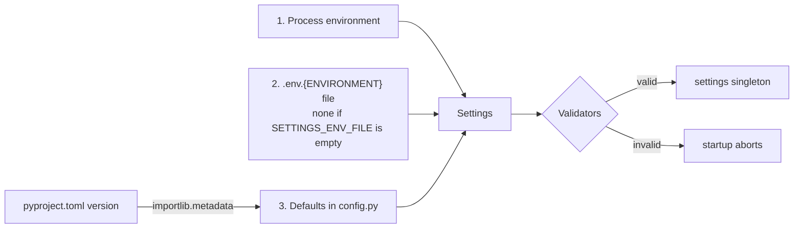

# Configuration

Every tunable value lives in one typed object, `settings` (`app/core/config.py`), built once at
import time from the environment. Invalid combinations stop the process at startup instead of
failing later in a request.

## Where each value comes from

`Settings` is a pydantic-settings model. For each field the first source that defines it wins:

1. **Environment variables** of the process.
2. **The env file** `.env.${ENVIRONMENT}` (`.env.local` when the variable is not in the process
   environment). `SETTINGS_ENV_FILE` overrides its path; an empty value reads no file at all.
3. **Defaults** in `config.py`. `APP_VERSION` defaults to the version of the installed package,
   read from `pyproject.toml`.

`ENVIRONMENT` is the only setting without a default: the process does not start until it is set.
`local` is the one value that skips the production validators below, so it has to be chosen, never
assumed. A developer gets it from `.env.local` (copied from `.env.example`); the Docker image sets
`ENVIRONMENT=production`, and compose overrides that with the env file.

`DATABASE_URL` is built from `DB_HOST`, `DB_PORT`, `DB_NAME`, `DB_USER` and `DB_PASSWORD` when it
is empty. Set it directly (pgbouncer, managed providers) and it wins; the LISTEN connections of
the event bus derive from it too.

## Validators

| Rule | Applies | Why |
|---|---|---|
| `ENVIRONMENT` is set | always | an unset value must not mean `local`, which accepts the placeholder key |
| `SECRET_KEY` is not the placeholder | outside `local` | a known key lets anyone sign tokens |
| `SECRET_KEY` has at least 32 bytes | outside `local` | HS256 needs a key as long as its output (RFC 7518, 3.2) |
| `JOB_LEASE_SECONDS >= 2 * JOB_HANDLER_TIMEOUT_SECONDS` | always | a shorter lease lets another worker recover a job that is still running |
| `ALLOWED_HOSTS` explicit, no `*` | outside `local` | requests for any host would be served |
| `ALLOWED_ORIGINS` explicit, no `*` | outside `local` | any site could call the API with the user's credentials |
| `FORWARDED_ALLOW_IPS` not `*` | outside `local` | any client could forge its IP (see `docs/security.md`) |

At startup (not a validator) the process must run in UTC outside `local`: `check_utc_timezone`
in `app/core/startup.py`.

Generate a key with `python -c "import secrets; print(secrets.token_urlsafe(48))"`.

## Adding a setting

1. Add the field to `Settings`, with a safe default for local development.
2. Add it to `.env.example`, active (`KEY=value`) or commented (`# KEY=`).
   `tests/unit/core/test_env_example_sync.py` fails if a field is missing or if the template
   lists a key that `Settings` does not define.
3. If a value is only invalid in production, validate it with a `model_validator` that skips
   `local`, and add a row to the table above.
4. Document it in the doc of the feature that uses it.

## Tests

`tests/conftest.py` sets `SETTINGS_ENV_FILE=""` and `ENVIRONMENT=local` before importing `app`, so
the suite never reads a developer's `.env.local` and behaves like CI. To test a validator, build a `Settings(...)`
with explicit values (see `tests/unit/core/test_settings.py`); to change a value the app already
read, patch the attribute on `app.core.config.settings`.
