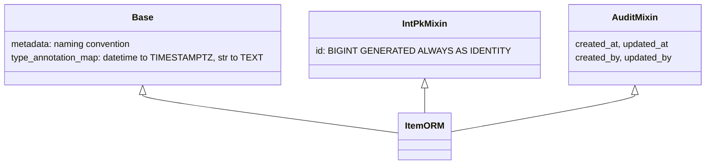

# Database access

## What it solves

Every request reads and writes through one async SQLAlchemy session, and everything it changes
is committed together or not at all, events included. Models share their primary key, audit
columns and naming rules, and repositories share pagination and filtering.

## One session per request

`get_session` (`app/core/db.py`) is the FastAPI dependency behind every repository. The figure
shows what happens to the changes of one request.


- Repositories call `flush()` (so ids and defaults are available) but never `commit()`.
- `get_session` commits when the endpoint finished without error and rolls back otherwise.
  Events published with `EventBus` live in the same session, so a failed request publishes
  nothing.
- Code that runs outside a request (workers, jobs, scripts) opens its own session with
  `async_session_factory()` and commits it explicitly.

## Engine and pool

| Setting | Default | Meaning |
|---|---|---|
| `DB_POOL_SIZE` | `5` | Connections kept open per process |
| `DB_MAX_OVERFLOW` | `10` | Extra connections under load |
| `DB_POOL_TIMEOUT` | `30` | Seconds to wait for a free connection |

`pool_pre_ping` discards dead connections before using them. With `--workers N`, the database
sees up to `N * (DB_POOL_SIZE + DB_MAX_OVERFLOW)` connections plus one LISTEN connection per
process for the event bus.

## Models



- **`Base`** gives every table the naming convention (`ix_`, `uq_`, `ck_`, `fk_`, `pk_`) that the
  migrations rely on, and maps `datetime` to `TIMESTAMPTZ` and `str` to `TEXT` unless a column
  says otherwise.
- **Mixins** (`app/models/mixins/`): `IntPkMixin` for the primary key, `AuditMixin` for
  timestamps and authorship.
- Defaults that exist in the database are declared with `server_default`, so rows inserted
  outside the ORM get them too and the migrations test can compare them.

## Repositories

`BaseRepo[T]` (`app/repos/base.py`) provides `create`, `get_by_id`, `update`, `delete`, offset
pagination (`list_paginated`, with the total from a window function in the same query) and cursor
pagination (`list_cursor`). A repository declares which query parameters it accepts as filters:

```python
class ItemRepo(BaseRepo[ItemORM]):
    model = ItemORM
    map_field: dict[str, FieldMapping] = {
        "name": {"column": ItemORM.name, "op": "ilike"},
        "category": {"column": ItemORM.category, "op": "eq"},
    }
```

Unknown filter keys are ignored and logged at warning level. Inject a repository in a router with
`Annotated[ItemRepo, Depends(get_repo(ItemRepo))]`.

## Helpers

- `rowcount(result)`: rows affected by an `UPDATE` or `DELETE` executed with `session.execute`.
- `build_asyncpg_dsn()`: plain DSN, derived from `DATABASE_URL`, for raw asyncpg connections
  (the event bus listener).

Schema changes are migrations: see [migrations.md](migrations.md).
