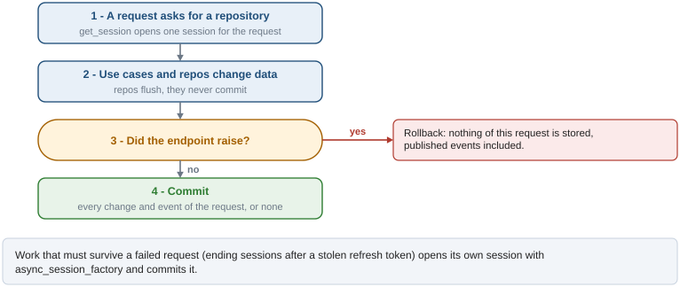
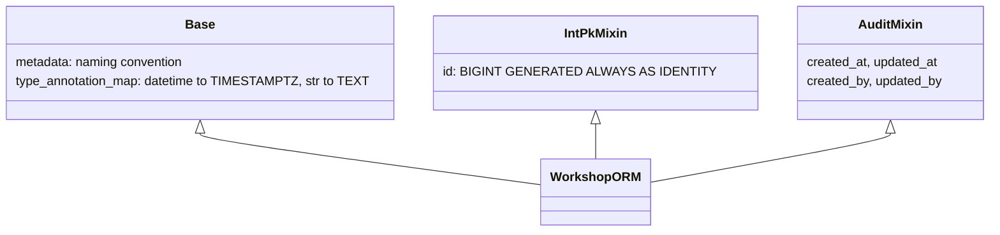

# Database access

Every request reads and writes through one async SQLAlchemy session, and everything it changes
is committed together or not at all, events included. Models share their primary key, audit
columns and naming rules, and repositories share pagination and filtering.

## One session per request

`get_session` (`app/core/db.py`) is the FastAPI dependency behind every repository. The figure
shows what happens to the changes of one request.



- Repositories call `flush()` (so ids and defaults are available) but never `commit()`.
- `get_session` commits when the endpoint finished without error and rolls back otherwise.
  Events published with `EventBus` live in the same session, so a failed request publishes
  nothing.
- The commit is part of the request: it runs before the response is sent, so a commit that fails
  reaches the client as an error and a 2xx means the data is stored. That is what
  `scope="function"` does in `Depends(get_session, scope="function")` (`app/deps/repository.py`,
  `app/deps/events.py`); with FastAPI's default scope the code after `yield` runs once the
  response is gone. Both places must use the same scope, or a request gets two sessions.
- Code that runs outside a request (workers, jobs, scripts) opens its own session with
  `async_session_factory()` and commits it explicitly.

## Engine and pool

| Setting | Default | Meaning |
|---|---|---|
| `DB_POOL_SIZE` | `5` | Connections kept open per process |
| `DB_MAX_OVERFLOW` | `10` | Extra connections under load |
| `DB_POOL_TIMEOUT` | `30` | Seconds to wait for a free connection |
| `DB_POOL_RECYCLE` | `1800` | Seconds before a connection is replaced, ahead of proxies that drop idle ones |
| `DB_CONNECT_TIMEOUT` | `10` | Seconds to open a connection (pool and event bus listener) |
| `DB_COMMAND_TIMEOUT` | `30` | Client-side limit (seconds) for one statement |
| `DB_STATEMENT_TIMEOUT_MS` | `30000` | Server-side `statement_timeout` of every app connection |
| `DB_LOCK_TIMEOUT_MS` | `5000` | Server-side `lock_timeout`: waiting for a lock fails instead of hanging |
| `DB_TRANSACTION_POOLER` | `false` | `DATABASE_URL` goes through a pooler in transaction mode (see below) |
| `DB_DIRECT_URL` | empty | PostgreSQL without the pooler, for the event bus listener and the migrations; empty means `DATABASE_URL` |

`pool_pre_ping` discards dead connections before using them. With `--workers N`, the database
sees up to `N * (DB_POOL_SIZE + DB_MAX_OVERFLOW)` connections plus one LISTEN connection per
process for the event bus; sizing for several replicas is in `docs/deployment.md`.

The timeouts are set per connection by `ENGINE_OPTIONS` (`app/core/db.py`); a stuck query or a
lock held by a migration fails the request instead of holding a worker forever.
`tests/integration/core/test_engine_settings.py` checks that PostgreSQL receives them. Migrations
use their own engine and are not limited by them.

**Behind a pooler in transaction mode** (`DB_TRANSACTION_POOLER=true`) a transaction may run on
a different server connection than the one before, so `engine_options()` keeps nothing on the
connection: asyncpg's and SQLAlchemy's caches of prepared statements are off and statements are
unnamed (PostgreSQL replaces the unnamed one with each new statement, so none piles up on the
server connections, which the pooler never resets), and the timeouts, which PgBouncer would
refuse at connect time, are set at the start of each transaction (`set_config(..., true)`, the
same as `SET LOCAL`; one round trip more per transaction). `ALTER ROLE <app role> SET
statement_timeout = '30s'` on the server avoids that round trip if the role is the app's alone.

## Models



- **`Base`** gives every table the naming convention (`ix_`, `uq_`, `ck_`, `fk_`, `pk_`) that the
  migrations rely on, and maps `datetime` to `TIMESTAMPTZ` and `str` to `TEXT` unless a column
  says otherwise.
- **Mixins** (`app/core/db.py`): `IntPkMixin` for the primary key, `AuditMixin` for
  timestamps and authorship. `created_by` and `updated_by` hold the id of the authenticated user
  of the request that wrote the row (`actor_var`, set by `get_current_user`); they are `NULL` for
  rows written by an anonymous request, a worker, a job or a script.
- Defaults that exist in the database are declared with `server_default`, so rows inserted
  outside the ORM get them too and the migrations test can compare them.

## Repositories

`BaseRepo[T]` (`app/core/repo.py`) provides `create`, `get_by_id`, `update`, `delete`, offset
pagination (`list_paginated`, with the total from a window function in the same query) and cursor
pagination (`list_cursor`). A repository declares which query parameters it accepts as filters:

```python
class WorkshopRepo(BaseRepo[WorkshopORM]):
    model = WorkshopORM
    map_field: dict[str, FieldMapping] = {
        "status": {"column": WorkshopORM.status, "op": "eq"},
        "title": {"column": WorkshopORM.title, "op": "ilike"},
        "starts_after": {"column": WorkshopORM.starts_at, "op": "gte"},
    }
```

Only the keys in `map_field` are filters; any other key is ignored and logged at warning level.
The operators are `eq`, `ilike`, `gte` and `lte`. An `ilike` filter is a case-insensitive
"contains" of the text as sent: `%` and `_` are escaped. Inject a repository in a router with
`Annotated[WorkshopRepo, Depends(get_repo(WorkshopRepo))]`.

Filters are what the client asked for. What the caller may see at all is a different thing and
has its own argument: both list methods take `scope`, a condition written by the repository
that is added to every query, the count included, and that no filter can widen:

```python
scope = or_(WorkshopORM.status != "draft", WorkshopORM.organizer_id == viewer_id)
await self.list_cursor(cursor=cursor, filters=filters, scope=scope)
```

A repository overrides `_base_select()` to say how its entity is loaded. `EnrollmentRepo` joins
the workshop of each enrollment there, and the relationship is `lazy="raise"`: in async code a
relationship is loaded by the query, never by touching the attribute.

A change that must not interleave with another one on the same row reads it with
`SELECT ... FOR UPDATE` (`WorkshopRepo.get_for_update`): the second transaction waits for the
first to end, up to `DB_LOCK_TIMEOUT_MS`, after which the request answers 503 `busy`.

Both paginations order by the requested field and then by `id`, so the order is total and pages
never repeat or skip a row when many rows share the sort value. `list_paginated` returns the total
of the filtered set on every page, including a page past the last one.

A cursor is base64 of a JSON object with the `id` of the last row and, when the list is sorted by
another field, the value of that field. It is client input: `decode_cursor` raises
`InvalidCursorError` (400, `invalid_cursor`) for anything else, for a sort value that is not of
the column's type, and for a cursor issued for a different `order_by`. Sort values are read back
into the Python type of their column, so a list can be sorted by a timestamp. A field offered for
sorting must be `NOT NULL`: the comparison of the next page has nothing to compare a NULL with.

## Helpers

- `rowcount(result)`: rows affected by an `UPDATE` or `DELETE` executed with `session.execute`.
- `build_asyncpg_dsn()`: plain DSN, derived from `DATABASE_URL`, for raw asyncpg connections
  (the event bus listener).

Schema changes are migrations: see [migrations.md](migrations.md).
