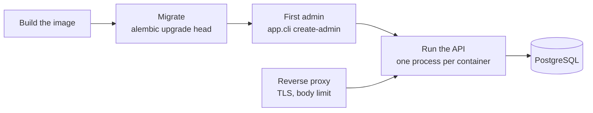
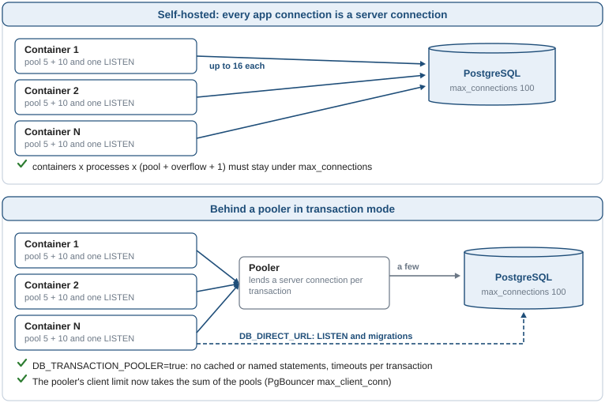

# Deployment

What a production deployment has to provide, in the order it happens: the settings the app
refuses to start without, the migrations, the first administrator, and what goes in front of the
API. The image is the same one compose builds (`docs/docker.md`).

## How it works



The image starts as `ENVIRONMENT=production`. In any environment other than `local` the settings
are validated when the process starts, and it exits with the reason instead of running with an
unsafe value (`docs/configuration.md`).

## Usage

```bash
docker build -t app .

# 1. Schema and reference data, once per release, before the new version serves traffic
docker run --rm --env-file .env.production --entrypoint alembic app upgrade head

# 2. The first administrator (asks for the password, or reads ADMIN_PASSWORD)
docker run --rm -it --env-file .env.production --entrypoint python app -m app.cli create-admin --email admin@example.com

# 3. The API
docker run -d --env-file .env.production -p 127.0.0.1:8000:8000 app
```

A production env file. Every line marked "required" stops the start-up when it is missing:

```bash
ENVIRONMENT=production                       # set by the image; any name except "local"
SECRET_KEY=<48 random bytes>                 # required: python -c "import secrets; print(secrets.token_urlsafe(48))"
ALLOWED_HOSTS=["api.example.com"]            # required: the names the API is reached by
ALLOWED_ORIGINS=["https://app.example.com"]  # required: browser frontends, or [] for none
FORWARDED_ALLOW_IPS=10.0.0.0/8               # required: the proxy address or subnet, or empty for none
HSTS_ENABLED=true                            # behind HTTPS

DB_HOST=db.internal
DB_PORT=5432
DB_NAME=app_db
DB_USER=app
DB_PASSWORD=<secret>
# or one URL; TLS is spelled ssl=, not sslmode=
# DATABASE_URL=postgresql+asyncpg://app:<secret>@db.internal:5432/app_db?ssl=require

METRICS_TOKEN=<random>                       # or keep /v1/metrics off the public network
# DOCS_ENABLED stays false: Swagger UI and /openapi.json are not served
```

## What goes in front

- **TLS** ends at the reverse proxy or the load balancer; the app speaks HTTP. Set
  `HSTS_ENABLED=true` once every client reaches it over HTTPS.
- **The proxy's address in `FORWARDED_ALLOW_IPS`.** The app takes the client address from
  `X-Forwarded-For` only when the request comes from a listed proxy. That address is the key of
  the rate limits and what the access log shows (`docs/security.md`).
- **The `Host` the client asked for**, passed through unchanged, and listed in `ALLOWED_HOSTS`.
  The health endpoints answer under any host, so probes need no special header.
- **A request body limit** (for example `client_max_body_size 1m` in nginx). The API bounds every
  field, but only the proxy stops a large body before it is read.
- **A path prefix**, if the API is published under one: start uvicorn with `--root-path /api`
  (or `UVICORN_ROOT_PATH=/api`) and let the proxy strip the prefix.

## Processes

- **One process per container, and scale containers.** The image starts a single uvicorn
  process. Rate limit counters and Prometheus counters live in the process, so with `--workers N`
  the effective limits are N times higher and each scrape sees one worker
  (`docs/security.md`, `docs/metrics.md`).
- **Workers.** Each API process also runs the outbox worker and the job worker; PostgreSQL makes
  that safe with any number of replicas. To scale them apart, set `OUTBOX_WORKER_ENABLED=false`
  and `JOB_WORKER_ENABLED=false` on the API and run `python -m app.cli worker` as another
  container of the same image (`docs/operations.md`).
- **Probes.** Liveness `GET /v1/health/liveness`, readiness `GET /v1/health/readiness`. The image
  has a `HEALTHCHECK` on liveness.
- **Shutdown.** uvicorn stops on SIGTERM; a handler or job cut short runs again later.

## Database

- **Migrations are a release step**, never part of the app start-up: run them once, then roll
  out the API (`docs/migrations.md`). They need a role that owns the schema; the API only needs
  to read and write rows and to `LISTEN`.
- **Connections** have a budget: see the next section.

## Scaling and connections

Every process of the API keeps its own pool. PostgreSQL takes a fixed number of connections
(`max_connections`, 100 by default, less the few reserved for superusers), so what limits how far
the API scales is usually the sum of the pools, not the work. The default is a PostgreSQL of your
own reached directly; behind a pooler, as most managed providers offer, two settings adapt the
app.



### Your own PostgreSQL (the default)

A deployment can open at most:

```
containers x processes x (DB_POOL_SIZE + DB_MAX_OVERFLOW + 1)
```

The `+ 1` is the `LISTEN` of the outbox worker, in every process that runs it. Add a container
of `python -m app.cli worker` (one pool and one `LISTEN`) if the workers run apart, and a few for
migrations and for whoever connects by hand. The sum must stay under `max_connections` minus
`superuser_reserved_connections` (97 on a default server).

| Deployment | At most |
|---|---|
| 1 container, 1 process, defaults | 1 x 16 = 16 |
| 4 containers, 1 process each, defaults | 4 x 16 = 64 |
| 4 containers, 2 processes each (`--workers 2`), defaults | 4 x 2 x 16 = 128: does not fit in 97 |
| the same with `DB_POOL_SIZE=5`, `DB_MAX_OVERFLOW=5` | 4 x 2 x 11 = 88 |
| the same with both workers off in the API and one worker container | 4 x 2 x 10 + 11 = 91 |

- **The pool of a process.** An async process serves many requests over a few connections: a
  request holds one only while its transaction runs. 5 kept and 10 more under load is ample for
  most APIs; raise it when requests wait for a connection (the `db_pool_checked_out` and
  `db_pool_overflow` gauges, `docs/metrics.md`), not before.
- **Containers rather than processes.** The image runs one process; scale by containers. The
  budget is the same either way, and the rate limits and the Prometheus counters, which live in
  the process, stay per container (`docs/security.md`, `docs/metrics.md`).
- **When the sum does not fit**, in this order: lower the pools; move the workers to their own
  container (`OUTBOX_WORKER_ENABLED=false` and `JOB_WORKER_ENABLED=false` in the API) to save a
  `LISTEN` and a job worker per process; raise `max_connections`, which costs memory on the server
  for every connection (a few hundred is fine on a modest server, thousands are not); or put a
  pooler in front, as below.
- **The startup table** (`docs/operations.md`) compares one instance with the server: its
  `Capacity` row turns `warn` when the instance alone does not fit. It cannot see the other
  replicas: the sum above is yours to do.

### Managed PostgreSQL, or a pooler of your own

A pooler sits between the app and PostgreSQL and lends a few server connections to many client
connections. In **transaction mode**, the one most managed providers give as their "pooled" URL
and the one that actually saves connections, a server connection is lent for one transaction:
the next transaction of the same client may run on another one. Anything kept on the connection
between transactions breaks, and four things in this app would. With the pooled URL in
`DATABASE_URL`, two more settings go together; the app does not start with the first and without
the second:

```bash
DATABASE_URL=postgresql+asyncpg://app:<secret>@pooler.example.com:6543/app_db?ssl=require
DB_TRANSACTION_POOLER=true
DB_DIRECT_URL=postgresql+asyncpg://app:<secret>@db.example.com:5432/app_db?ssl=require
```

| What breaks in transaction mode | What the app does with `DB_TRANSACTION_POOLER=true` |
|---|---|
| A prepared statement cached on one server connection is missing on the next | No statement is cached or named (`docs/database.md`) |
| `statement_timeout` and `lock_timeout` sent at connect time are refused | They are set at the start of each transaction |
| A `LISTEN` stays on a server connection lent to others, and hears nothing | It goes to `DB_DIRECT_URL` |
| The session lock that picks one process to print the startup table | Every process prints its table |

- **`DB_DIRECT_URL`** is the provider's direct (or session-mode) URL, and it is required: the
  `LISTEN` and the migrations use it. DDL and long transactions do not belong in a transaction
  pooler, and every run of the migrations would meet the prepared statements the run before
  left on its connections.
- **Size the pooler for the pools.** Its client limit (`max_client_conn` in PgBouncer) now takes
  the sum of the table above, and its server pool what PostgreSQL allows.
- **A pooler in session mode** keeps a server connection per client connection: nothing breaks
  and nothing needs changing, but it saves little.
- `tests/integration/core/test_pooler.py` runs the engine against PgBouncer 1.26 in transaction
  mode with two server connections and no prepared statement support, the worst case, and
  `tests/integration/api/test_behind_a_pooler.py` an enrollment through it.

## Guarantees and limits

- The process refuses to start with the placeholder `SECRET_KEY`, a key shorter than 32 bytes,
  wildcard or unset hosts, origins and trusted proxies, or a time zone other than UTC, in every
  environment except `local`. CI builds the image and checks both that it refuses to start
  unconfigured and that it becomes healthy with the settings above.
- Registration is open to anyone and grants the `user` role. A deployment that must not accept
  sign-ups removes or guards that route.
- Not covered here because they belong to the platform: backups, secret storage and rotation
  (changing `SECRET_KEY` ends every session), log shipping, alerting.
- Not tested with this code base: the proxies of each managed provider (PgBouncer in transaction
  mode is), Kubernetes manifests, and multi-region setups.

## Files

| File | Role |
|---|---|
| `Dockerfile` | The image: `ENVIRONMENT=production`, non-root, health check |
| `app/core/config.py` | Settings and the validators that stop an unsafe start-up |
| `app/core/db.py` | `engine_options()`: the engine, direct or behind a transaction pooler |
| `app/cli.py` | `create-admin` and the worker process |
| `.github/workflows/ci.yml` | The `image` job that builds and starts the image |
