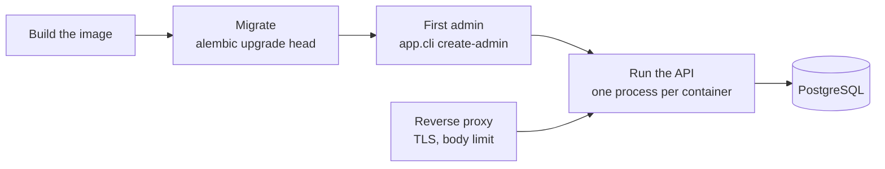

# Deployment

What a production deployment has to provide, in the order it happens: the settings the app
refuses to start without, the migrations, the first administrator, and what goes in front of the
API. The image is the same one compose builds (`docs/docker.md`).

## How it works



The image starts as `ENVIRONMENT=production`. In any environment other than `local` the settings
are validated when the process starts, and it exits with the reason instead of running with an
unsafe value (`docs/configuration.md`).

## Usage

```bash
docker build -t app .

# 1. Schema and reference data, once per release, before the new version serves traffic
docker run --rm --env-file .env.production --entrypoint alembic app upgrade head

# 2. The first administrator (asks for the password, or reads ADMIN_PASSWORD)
docker run --rm -it --env-file .env.production --entrypoint python app -m app.cli create-admin --email admin@example.com

# 3. The API
docker run -d --env-file .env.production -p 127.0.0.1:8000:8000 app
```

A production env file. Every line marked "required" stops the start-up when it is missing:

```bash
ENVIRONMENT=production                       # set by the image; any name except "local"
SECRET_KEY=<48 random bytes>                 # required: python -c "import secrets; print(secrets.token_urlsafe(48))"
ALLOWED_HOSTS=["api.example.com"]            # required: the names the API is reached by
ALLOWED_ORIGINS=["https://app.example.com"]  # required: browser frontends, or [] for none
FORWARDED_ALLOW_IPS=10.0.0.0/8               # required: the proxy address or subnet, or empty for none
HSTS_ENABLED=true                            # behind HTTPS

DB_HOST=db.internal
DB_PORT=5432
DB_NAME=app_db
DB_USER=app
DB_PASSWORD=<secret>
# or one URL; TLS is spelled ssl=, not sslmode=
# DATABASE_URL=postgresql+asyncpg://app:<secret>@db.internal:5432/app_db?ssl=require

METRICS_TOKEN=<random>                       # or keep /v1/metrics off the public network
# DOCS_ENABLED stays false: Swagger UI and /openapi.json are not served
```

## What goes in front

- **TLS** ends at the reverse proxy or the load balancer; the app speaks HTTP. Set
  `HSTS_ENABLED=true` once every client reaches it over HTTPS.
- **The proxy's address in `FORWARDED_ALLOW_IPS`.** The app takes the client address from
  `X-Forwarded-For` only when the request comes from a listed proxy. That address is the key of
  the rate limits and what the access log shows (`docs/security.md`).
- **The `Host` the client asked for**, passed through unchanged, and listed in `ALLOWED_HOSTS`.
  The health endpoints answer under any host, so probes need no special header.
- **A request body limit** (for example `client_max_body_size 1m` in nginx). The API bounds every
  field, but only the proxy stops a large body before it is read.
- **A path prefix**, if the API is published under one: start uvicorn with `--root-path /api`
  (or `UVICORN_ROOT_PATH=/api`) and let the proxy strip the prefix.

## Processes

- **One process per container, and scale containers.** The image starts a single uvicorn
  process. Rate limit counters and Prometheus counters live in the process, so with `--workers N`
  the effective limits are N times higher and each scrape sees one worker
  (`docs/security.md`, `docs/metrics.md`).
- **Workers.** Each API process also runs the outbox worker and the job worker; PostgreSQL makes
  that safe with any number of replicas. To scale them apart, set `OUTBOX_WORKER_ENABLED=false`
  and `JOB_WORKER_ENABLED=false` on the API and run `python -m app.cli worker` as another
  container of the same image (`docs/operations.md`).
- **Probes.** Liveness `GET /v1/health/liveness`, readiness `GET /v1/health/readiness`. The image
  has a `HEALTHCHECK` on liveness.
- **Shutdown.** uvicorn stops on SIGTERM; a handler or job cut short runs again later.

## Database

- **Migrations are a release step**, never part of the app start-up: run them once, then roll
  out the API (`docs/migrations.md`). They need a role that owns the schema; the API only needs
  to read and write rows and to `LISTEN`.
- **Connections.** Each API process holds up to `DB_POOL_SIZE + DB_MAX_OVERFLOW` connections plus
  one for `LISTEN` (`docs/database.md`). Size `max_connections` for the number of replicas.
- **A connection pooler in transaction mode** cannot carry `LISTEN`, which needs a session:
  point the app at PostgreSQL directly, or expect the outbox to work by polling only.

## Guarantees and limits

- The process refuses to start with the placeholder `SECRET_KEY`, a key shorter than 32 bytes,
  wildcard or unset hosts, origins and trusted proxies, or a time zone other than UTC, in every
  environment except `local`. CI builds the image and checks both that it refuses to start
  unconfigured and that it becomes healthy with the settings above.
- Registration is open to anyone and grants the `user` role. A deployment that must not accept
  sign-ups removes or guards that route.
- Not covered here because they belong to the platform: backups, secret storage and rotation
  (changing `SECRET_KEY` ends every session), log shipping, alerting.
- Not tested with this code base: PgBouncer and managed PostgreSQL proxies, Kubernetes
  manifests, and multi-region setups.

## Files

| File | Role |
|---|---|
| `Dockerfile` | The image: `ENVIRONMENT=production`, non-root, health check |
| `app/core/config.py` | Settings and the validators that stop an unsafe start-up |
| `app/cli.py` | `create-admin` and the worker process |
| `.github/workflows/ci.yml` | The `image` job that builds and starts the image |
