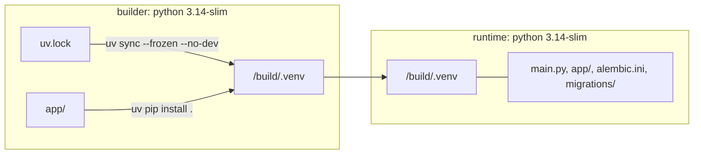

# Docker

A two-stage image that contains the locked virtualenv and only the files the app reads at
runtime, runs as a non-root user in UTC, and serves the API with uvicorn. `docker-compose.yml`
runs PostgreSQL, the migrations and the API for local work.

## How the image is built



- **builder** installs the locked dependencies, then the project itself (so `importlib.metadata`
  gives `APP_VERSION`). Dependencies are installed before the code is copied, so a code change
  reuses the dependency layer. `uv` comes from a pinned image tag.
- **runtime** copies the virtualenv and an explicit list of paths (`main.py`, `alembic.ini`,
  `app/`, `migrations/`); never `COPY . .`. pip, setuptools and wheel are removed. It runs as
  uid/gid 1000 with `TZ=UTC`, exposes 8000 and has a `HEALTHCHECK` on `/v1/health/liveness`.
- `.dockerignore` keeps the build context small and lets no `.env.*` file in except
  `.env.example`.

## Usage

```bash
docker build -t app .
docker run --env-file .env.prod -p 8000:8000 app                 # the API
docker run --env-file .env.prod --entrypoint alembic app upgrade head   # the migrations
```

Local development with compose:

```bash
docker compose up db -d        # PostgreSQL 18 on localhost:${DB_PORT:-5434}
docker compose up --build      # db, then migrate (alembic upgrade head), then api
docker compose exec api python scripts/seed_dev.py
```

| Service | Role |
|---|---|
| `db` | `postgres:18-alpine`, volume `pgdata18`, healthcheck with `pg_isready` |
| `migrate` | The API image running `alembic upgrade head`, then exits |
| `api` | Starts after `migrate` succeeded; mounts the repo and runs uvicorn with `--reload` |

`docker-compose.observability.yml` adds Prometheus and Grafana (`docs/metrics.md`).

To add a file to the image, add it to the runtime `COPY` list, with a comment if the reason is
not obvious.

## Guarantees and limits

- `tests/unit/test_dockerfile_runtime_copy.py` fails if the runtime stage copies the whole
  context, copies a path that does not exist, or copies a path excluded by `.dockerignore`.
- CI lints the Dockerfile with hadolint; Dependabot proposes base image updates weekly.
- The volume name carries the PostgreSQL major version: a volume created by another major
  version cannot be reused.
- The image does not run the migrations on start; run them as a separate step (`docs/migrations.md`).
