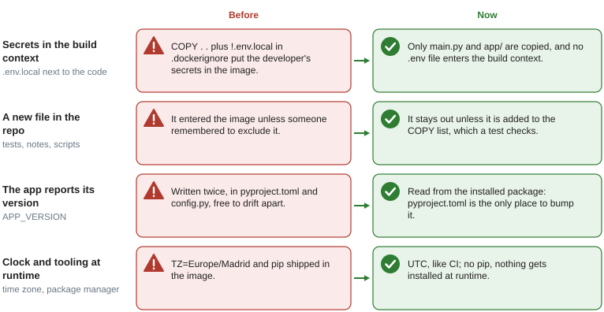

# Docker

## What it solves

One image runs the API anywhere: same Python, same dependencies, same time zone as CI. The image
must contain what the app needs at runtime and nothing else: no secrets, no tests, no package
manager.

## The image

The `Dockerfile` has two stages:

| Stage | What it does |
|---|---|
| `builder` | Installs the locked dependencies (`uv sync --frozen --no-dev`) into `/build/.venv`, then installs the project itself so `importlib.metadata` can read its version |
| `runtime` | Copies the virtualenv and an allow-list of files (`main.py`, `app/`, `alembic.ini`, `migrations/`), removes pip, runs as uid 1000 with `TZ=UTC` |

Dependencies are installed before the code is copied, so a code change reuses the cached
dependency layer. `uv` comes from a pinned image tag (`ghcr.io/astral-sh/uv:<version>`) so a uv
release cannot change the build.

## What changed and why

Four details decide what ends up inside the image. The figure compares them with the previous
Dockerfile.



- **Allow-list.** The runtime stage copies named paths, never `COPY . .`. A deny-list fails
  silently: anything new is shipped until someone excludes it. `.dockerignore` still keeps the
  build context small and never lets an `.env.*` file in (only `.env.example`).
- **The list is tested.** `tests/unit/test_dockerfile_runtime_copy.py` fails if the runtime stage
  copies the whole context, copies a path that does not exist, or copies a path that
  `.dockerignore` excludes (that last one would only fail when the image is built).
- **Version.** `APP_VERSION` defaults to the installed package version, so `pyproject.toml` is
  the only place to bump it.
- **UTC.** A naive datetime sent to a `timestamptz` column is interpreted in the process time
  zone; running everything in UTC keeps that interpretation identical in tests and production.

Add a path to the runtime `COPY` list only when the app reads it at runtime, and say why in a
comment.

## Local development with compose

```bash
docker compose up db -d          # PostgreSQL 18 on localhost:${DB_PORT:-5434}
docker compose up --build        # db, then migrate (alembic upgrade head), then the API
```

`migrate` runs the image with `alembic upgrade head` and exits; `api` starts only if it
succeeded (see `docs/migrations.md`). The data volume is `pgdata18`: a volume created by an older
PostgreSQL major version cannot be reused, so the name changes with the major version. The `api` service mounts the repository on `/app` and runs uvicorn with `--reload`, so the image
content is only used for its virtualenv. `docker-compose.observability.yml` adds Prometheus and
Grafana (see `docs/metrics.md`).

## Checks

| Check | Where |
|---|---|
| `hadolint` with failure threshold `warning` | CI, `lint` job |
| Allow-list tests | `tests/unit/test_dockerfile_runtime_copy.py` |
| Base image updates | Dependabot, `docker` ecosystem, weekly |
