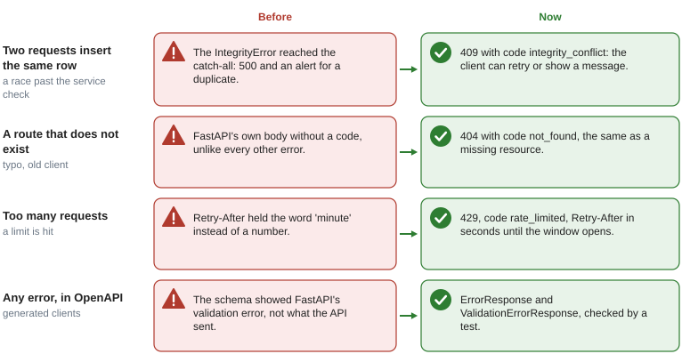

# Errors

## What it solves

A client must be able to react to an error without parsing English. Every error response has
the same shape and a stable machine-readable `code`, whatever produced it: a domain rule, a
missing route, bad input, a rate limit or a bug.

```json
{"detail": "Item not found (ID: 42)", "code": "not_found"}
{"detail": "Validation error", "code": "validation_error", "errors": ["body.name: Field required"]}
```

`detail` is for humans and may change; `code` is the contract.

## Where each error comes from

Global handlers (`app/core/exceptions/handlers.py`) turn every failure into that body.
The figure shows the cases that used to answer differently.



| Source | Status | `code` |
|---|---|---|
| `NotFoundError` | 404 | `not_found` |
| `ConflictError` | 409 | `conflict` |
| `BusinessValidationError` / `UseCaseException` | 400 | `business_validation` / `use_case_error` |
| `AuthenticationError` | 401 | `unauthenticated` (plus `WWW-Authenticate: Bearer`) |
| `RefreshTokenReuseError` | 401 | `refresh_token_reused` (every session of the user ended) |
| `AuthorizationError` | 403 | `forbidden` |
| Request validation | 422 | `validation_error`, per-field messages in `errors` |
| `IntegrityError` that reached the handler | 409 | `integrity_conflict` |
| Rate limit | 429 | `rate_limited`, `Retry-After` in seconds |
| `HTTPException` (unknown route, wrong method...) | its status | `not_found`, `method_not_allowed`... |
| Anything else | 500 | `internal_error`; the message is logged, never returned |

## Raising errors

Raise domain exceptions from services and use cases, never `HTTPException`:

```python
from app.core.exceptions import NotFoundError

item = await self.repo.get_by_id(item_id)
if item is None:
    raise NotFoundError("Item", item_id)
```

A new error type subclasses the closest one and sets its `code` (and `status_code` if it
differs):

```python
class OutOfStockError(BusinessValidationError):
    code = "out_of_stock"
```

Check uniqueness in the service to give a precise error (`ConflictError("User", "email already
registered")`); the `integrity_conflict` handler is the safety net for the race between that
check and the INSERT.

## In OpenAPI

`app/core/exceptions/schemas.py` defines `ErrorResponse` and `ValidationErrorResponse` with
`extra="forbid"`, and `main.py` declares them for every operation (`responses=ERROR_RESPONSES`),
so generated clients get the real shape instead of FastAPI's default validation error.

## Tests

`tests/functional/test_error_contract.py` calls every registered handler and validates the body
against the schemas, fails if a new handler appears without being checked, sends real requests
(unknown route, wrong method, missing token, invalid body, duplicate) and checks the OpenAPI
references.
