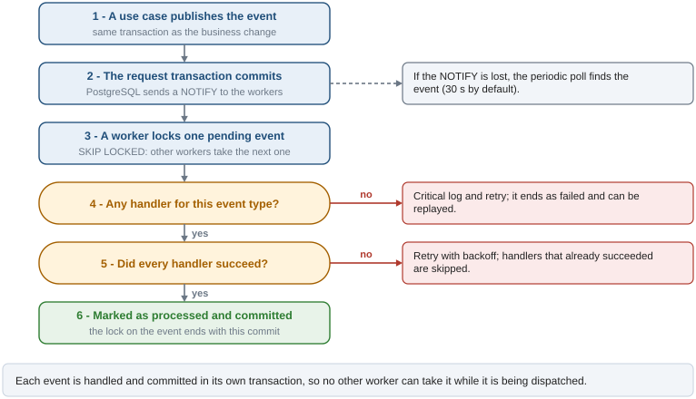
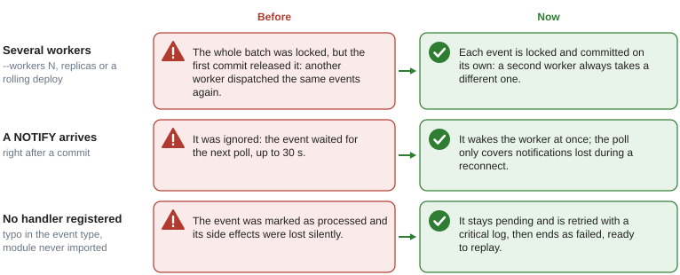

# Event bus (transactional outbox)

## What it solves

A use case often needs side effects outside its own data: send an email, call a webhook,
notify another service. Doing them inline couples the request to slow or flaky systems, and
doing them after the commit loses them if the process dies in between.

The event bus stores each event as a row in `outbox_events`, **in the same transaction as the
business change**. A background worker in every API process later reads those rows and runs
the handlers registered for each event type. PostgreSQL is the only moving part: no Redis, no
RabbitMQ.

- **Atomic**: if the use case fails, the event row is rolled back with everything else.
- **Durable**: a committed event survives restarts; it is retried until its handlers succeed.
- **Fast**: a `NOTIFY` wakes the workers right after the commit; polling is only a fallback.

## How an event travels

The use case publishes, the request commits, and the commit wakes the workers. One of them
locks the event, runs its handlers and commits the outcome. The figure follows a single event
through those steps, including the two ways it can go back to pending.



The worker loop (`app/core/events/worker.py`) keeps a dedicated asyncpg connection that runs
`LISTEN outbox_event_channel`. `EventBus.publish` calls `pg_notify` inside the request
transaction, and PostgreSQL delivers the notification when that transaction commits. The
notification only wakes the worker; what to process is always read from the table, so a lost
notification costs at most one poll interval (`OUTBOX_POLL_INTERVAL_SECONDS`).

## What it guarantees and what it does not

| Guaranteed | Not guaranteed |
|---|---|
| An event exists only if the business change committed | Order between events (see [Known limitations](#known-limitations)) |
| Each pending event is dispatched by one worker at a time, even with `--workers N` or replicas | Exactly-once side effects: a crash after a handler succeeds but before the commit re-runs it, so handlers must be idempotent |
| Handlers that already succeeded are skipped on retries | Delivery within a deadline: failures back off up to one hour |
| An event with no registered handler is never acknowledged | |

## Several workers, lost notifications, missing handlers

Three situations used to break those guarantees. The figure shows what happened before and what
happens now.



- **One event per transaction.** `_process_batch` locks a single pending event with
  `FOR UPDATE SKIP LOCKED`, handles it and commits, up to 50 times per wake-up. The lock lasts
  until that commit, so no other worker can take the event while it is being dispatched.
  Locking a whole batch and committing inside the loop released the locks of the rows still
  waiting after the first commit.
- **Events without handlers.** The dispatcher returns `no_handlers=True` and logs at CRITICAL.
  The worker treats it as a failure: the event is retried with backoff and ends as `FAILED`
  after `max_retries`, so it can be replayed once the handler is deployed.

## Publishing an event

Publish from a use case, with the same session as the business change:

```python
from dataclasses import dataclass

from app.core.events.bus import EventBus
from app.services.orders import OrderService


@dataclass(slots=True)
class CreateOrderUseCase:
    order_service: OrderService
    event_bus: EventBus

    async def execute(self, ...) -> OrderORM:
        order = await self.order_service.create(...)

        await self.event_bus.publish(
            event_type="order.created",
            payload={"order_id": order.id, "email": order.user_email},
            aggregate_id=order.uuid,       # optional: groups events by entity
            correlation_id=request_uuid,   # optional: traces end-to-end flows
        )
        return order
        # get_session() commits the order and the event together
```

In the router, inject the bus with `EventBusDep`:

```python
from typing import Annotated

from fastapi import Depends

from app.core.events.bus import EventBus
from app.deps.events import get_event_bus

EventBusDep = Annotated[EventBus, Depends(get_event_bus)]


@router.post("")
async def create_order(service: OrderServiceDep, event_bus: EventBusDep, ...):
    uc = CreateOrderUseCase(service, event_bus)
    ...
```

## Writing a handler

### 1. Write the handler

```python
# app/core/events/handlers/orders.py
import logging

from app.core.events.dispatcher import dispatcher

logger = logging.getLogger(__name__)


@dispatcher.register("order.created")
async def send_order_confirmation(payload: dict) -> None:
    # ... send the email (check idempotency first)
    logger.info("Sent confirmation for order %s", payload["order_id"])
```

### 2. Register the module

The decorator only runs if the module is imported. An event type nobody imports a handler for
is retried and ends as `FAILED` (see above), so add the import:

```python
# app/core/events/handlers/__init__.py
import app.core.events.handlers.items   # noqa: F401
import app.core.events.handlers.orders  # noqa: F401
```

### 3. Make it idempotent

Handlers that succeeded on a previous attempt are skipped on retry (see
[Handler state](#handler-state)). Still, a crash between the handler's side effect and the
commit of its state re-runs it, so check before acting:

```python
@dispatcher.register("order.created")
async def send_order_confirmation(payload: dict) -> None:
    if await email_service.was_sent(ref=f"order-{payload['order_id']}"):
        return
    await email_service.send(...)
```

## Configuration

| Setting | Default | Description |
|---|---|---|
| `OUTBOX_POLL_INTERVAL_SECONDS` | `30` | Fallback poll when no NOTIFY arrives |
| `OUTBOX_MAX_RETRIES` | `5` | Attempts before an event is marked `FAILED` |
| `OUTBOX_HANDLER_TIMEOUT_SECONDS` | `30` | Timeout of each handler |
| `OUTBOX_CLEANUP_DAYS` | `30` | Retention of `PROCESSED` events |
| `OUTBOX_CLEANUP_BATCH_SIZE` | `1000` | Rows per DELETE during cleanup |

## Retry and backoff

When a handler fails, or there is no handler at all:

1. `retry_count` is incremented.
2. `last_error` keeps the error of each failed handler.
3. `handler_state` records the outcome per handler.
4. `scheduled_at` moves to `now() + min(2^retry_count + random(0..5 s), 1 hour)`.
5. The event stays `PENDING` until `scheduled_at`.

The jitter avoids a thundering herd when an external service fails for many events at once; the
one-hour cap keeps late retries reasonable. When `retry_count` reaches `max_retries` the event
is marked `FAILED` and logged at CRITICAL.

```
PENDING -> retry (backoff) -> ... -> FAILED -> replay_failed_events() -> PENDING
```

### Handler state

The `handler_state` JSONB column records which handlers succeeded on each attempt:

```json
{
  "log_item_created":     {"status": "ok",     "at": "2026-03-21T10:00:00+00:00"},
  "webhook_item_created": {"status": "failed", "at": "2026-03-21T10:00:01+00:00", "error": "TimeoutError..."}
}
```

On retry, handlers marked `"ok"` are skipped and only failed or new handlers run. The state is
committed together with the event, one event per transaction. To force every handler to run
again during a replay (for example after fixing one):

```python
await replay_failed_events(reset_handler_state=True)
```

## Operations

```python
from app.core.events.cleanup import cleanup_processed_events, replay_failed_events

await cleanup_processed_events()             # deletes PROCESSED older than OUTBOX_CLEANUP_DAYS
await cleanup_processed_events(days=7)       # custom retention
await replay_failed_events()                 # every FAILED event back to PENDING
await replay_failed_events(event_ids=[id1])  # only some
```

The worker runs in every API process, starts in the lifespan when the database is reachable and
is available as `app.state.outbox_worker`.

## Known limitations

1. **No ordering between events.** With several workers, `order.paid` can be dispatched before
   `order.created`. Handlers must check the current state of the entity and raise if it is not
   ready; the retry gives the other event time to be processed.
2. **Timeouts cancel handlers.** `asyncio.wait_for` cancels a handler that overruns its timeout.
   If it already produced an external effect without recording it, the retry repeats it. Wrap
   critical external calls in `asyncio.shield()` and record their result.
3. **Handler state is keyed by function name.** Renaming a handler makes pending retries run it
   again. Keep names of critical handlers stable.
4. **The LISTEN connection lives outside the pool.** Each process keeps one extra connection to
   PostgreSQL. A `SELECT 1` heartbeat per cycle detects dead connections and the worker
   reconnects with exponential backoff.
