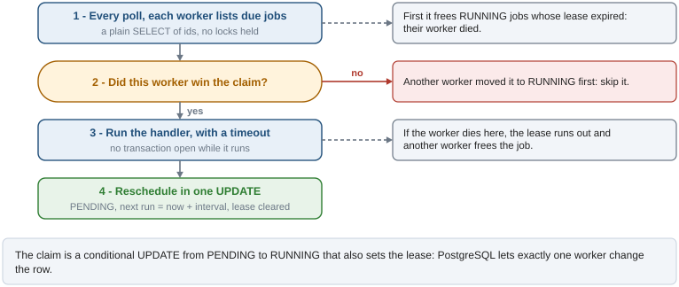
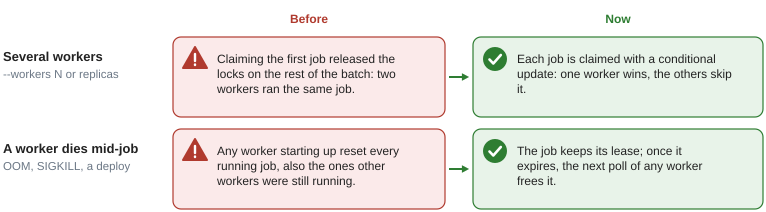

# Scheduled jobs

## What it solves

Recurring background tasks (clean expired tokens, send a daily digest, poll an external API)
need to run on a schedule and exactly once per run, even when the API runs as several processes
(`uvicorn --workers N`) or replicas. A cron daemon per container would run them N times; Celery
or a broker adds infrastructure.

Jobs are rows in `scheduled_jobs`, one per job, each with a fixed `interval_seconds`. A
`JobWorker` in every API process polls the table and runs the jobs that are due. PostgreSQL
decides which worker runs each job, so no coordination between processes is needed.

## How a job runs

Every `JOB_POLL_INTERVAL_SECONDS` each worker does the same four steps. The figure shows them,
including the two places where another worker or a crash can interfere.



1. **Recover and list.** First the worker frees `RUNNING` jobs whose lease expired (their worker
   died). Then it reads the ids of the `PENDING` jobs whose `next_run_at` has passed, without
   locking anything.
2. **Claim.** For each id, one `UPDATE ... WHERE status = 'PENDING' AND next_run_at <= now()
   RETURNING ...` moves the row to `RUNNING`, sets `claimed_by = hostname:PID` and
   `lease_until = now + JOB_LEASE_SECONDS`, and commits. If the update returns no row, another
   worker claimed the job first and this one skips it.
3. **Run.** The handler runs with a `JOB_HANDLER_TIMEOUT_SECONDS` timeout and no transaction
   open, so a slow job holds no locks or connections.
4. **Reschedule.** A single `UPDATE` sets `PENDING`, `next_run_at = now + interval_seconds`,
   `last_run_at`, `last_error`, clears the lease and increments `run_count` in SQL. Jobs are
   rescheduled even when the handler fails.

## What it guarantees and what it does not

| Guaranteed | Not guaranteed |
|---|---|
| A due job is claimed by one worker, whatever the number of processes | Exact timing: a job runs within one poll interval of `next_run_at` |
| A crashed worker's job is recovered once its lease expires | No overlap if a handler runs longer than its lease (the validator keeps the lease at least twice the handler timeout) |
| A failing job keeps its schedule | Retries sooner than the next interval |

## Several workers and crashes

Two situations used to run jobs twice. The figure compares the old behavior with the current one.



- **Concurrent workers.** The old worker locked a batch with `FOR UPDATE SKIP LOCKED` and
  committed after claiming the first job, which released the locks on the rest: another worker
  could claim and run them while the first one ran them too. Now each claim is its own
  conditional update.
- **Crashes.** The old worker reset *every* `RUNNING` job to `PENDING` when it started, including
  jobs that other workers were running. Now only jobs with an expired lease (or no lease) are
  recovered, on every poll.

## Creating a job

### 1. Write the handler

```python
# app/<context>/jobs/cleanup.py  (infrastructure jobs: app/core/jobs/handlers/)
import logging

from app.core.jobs.registry import job_registry

logger = logging.getLogger(__name__)


@job_registry.register("daily_cleanup")
async def daily_cleanup() -> None:
    # ... your logic here
    logger.info("Cleanup done")
```

### 2. Register the module

```python
# app/db_registry.py
import app.items.jobs.cleanup  # noqa: F401
```

See `app/auth/jobs/revoked_tokens_cleanup.py` for a real one.

### 3. Insert the job row

A job runs only if its row exists. Rows are reference data, so they come with a migration
(see `migrations/versions/0002_seed_reference_data.py`):

```python
def upgrade() -> None:
    op.execute(
        "INSERT INTO scheduled_jobs (job_name, description, interval_seconds) "
        "VALUES ('daily_cleanup', 'Removes stale temp data', 86400) "
        "ON CONFLICT (job_name) DO NOTHING"
    )


def downgrade() -> None:
    op.execute("DELETE FROM scheduled_jobs WHERE job_name = 'daily_cleanup'")
```

A row whose handler is not registered is still claimed and rescheduled, with
`last_error = "No handler registered for job ..."`.

## Configuration

| Setting | Default | Description |
|---|---|---|
| `JOB_POLL_INTERVAL_SECONDS` | `15` | How often each worker looks for due jobs |
| `JOB_HANDLER_TIMEOUT_SECONDS` | `60` | Maximum run time of a handler |
| `JOB_LEASE_SECONDS` | `120` | How long a claimed job belongs to its worker; must be at least twice the handler timeout |

## Table

```sql
CREATE TABLE scheduled_jobs (
    id               UUID PRIMARY KEY DEFAULT gen_random_uuid(),
    job_name         VARCHAR(255) NOT NULL UNIQUE,
    description      TEXT,
    interval_seconds INT          NOT NULL,
    status           VARCHAR(20)  NOT NULL DEFAULT 'PENDING'
                         CHECK (status IN ('PENDING', 'RUNNING', 'DISABLED')),
    last_run_at      TIMESTAMPTZ,
    next_run_at      TIMESTAMPTZ  NOT NULL DEFAULT now(),
    last_error       TEXT,
    run_count        INT          NOT NULL DEFAULT 0,
    claimed_by       TEXT,
    lease_until      TIMESTAMPTZ,
    created_at       TIMESTAMPTZ  NOT NULL DEFAULT now(),
    updated_at       TIMESTAMPTZ
);
```

- `status`: `PENDING` (waiting), `RUNNING` (claimed), `DISABLED` (paused, never claimed).
- `claimed_by` / `lease_until`: owner of a running job and until when it owns it.
- `run_count`: successful and failed runs.

## Operations

```sql
-- Pause and resume a job
UPDATE scheduled_jobs SET status = 'DISABLED' WHERE job_name = 'daily_cleanup';
UPDATE scheduled_jobs SET status = 'PENDING', next_run_at = now() WHERE job_name = 'daily_cleanup';

-- Run it on the next poll
UPDATE scheduled_jobs SET next_run_at = now() WHERE job_name = 'daily_cleanup';

-- Health
SELECT job_name, status, claimed_by, lease_until, run_count, last_run_at, next_run_at, last_error
FROM scheduled_jobs;
```

## Jobs and the event bus

| | Event bus | Scheduled jobs |
|---|---|---|
| Trigger | A use case publishes an event | Time (fixed interval) |
| Table | `outbox_events`, one row per event | `scheduled_jobs`, one row per job, reused |
| Handlers | Several per event type | One per job |
| Payload | Event data | None: the handler reads what it needs |
| Failure | Backoff, then `FAILED` after max retries | Runs again at the next interval |
| Wake-up | LISTEN/NOTIFY plus poll | Poll only |

A job without payload that needs per-entity work can publish events and let event handlers do
it: the job stays short and each entity gets the event bus retries.

## Known limitations

1. **Fixed interval only.** No cron expressions; `croniter` could be added if needed.
2. **One timeout for all jobs.** `JOB_HANDLER_TIMEOUT_SECONDS` applies to every handler, and a
   failed job waits for its next interval.
3. **Long handlers need a longer lease.** A handler that outlives `JOB_LEASE_SECONDS` can be
   recovered and run by another worker while it is still running. The timeout plus the validator
   prevent it with the defaults; keep the relation if you change them.
