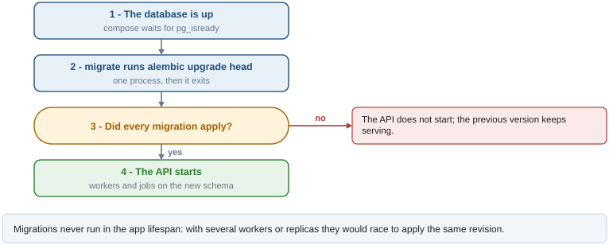
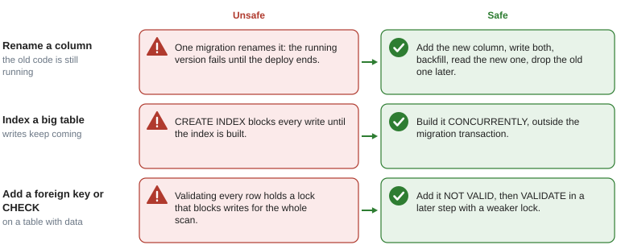

# Migrations

Alembic owns the schema. Revisions live in `migrations/versions/`, numbered (`0001_baseline`,
`0002_seed_reference_data`, ...); `alembic_version` records the revision a database is at.
`migrations/env.py` is async and reads the same configuration as the app: `DB_DIRECT_URL` when
it is set, as a pooler in transaction mode requires (DDL and long transactions do not belong in
one, see `docs/deployment.md`), otherwise `DATABASE_URL`.

## How a deploy applies them

Migrations run as a separate step before the API starts, never inside the app. The figure follows
a `docker compose up`.



- `docker-compose.yml` has a `migrate` service that runs `alembic upgrade head` with the API image
  and exits. `api` depends on it with `condition: service_completed_successfully`.
- In production, do the same: run `alembic upgrade head` once (a job or a release step), then
  roll out the API.

## Daily workflow

```bash
uv run alembic upgrade head                                  # bring a database up to date
uv run alembic revision --autogenerate --rev-id 0010 -m "add workshops location"  # draft from the models
uv run alembic downgrade -1                                  # undo the last one (local only)
uv run alembic current                                       # where this database is
```

1. Change the models.
2. Generate the draft with `--autogenerate` and **read it**: autogenerate does not see renames
   (it emits a drop plus an add), data migrations, `CONCURRENTLY`, or changes to partial index
   predicates.
3. Write `downgrade()` so that it really undoes `upgrade()`.
4. Run the tests: `tests/integration/test_migrations.py` fails if the models and the migrated
   schema differ, and replays every migration down to base and up again.

Revisions are numbered (`0010_add_workshops_location.py`): `--rev-id` keeps the sequence.
CI fails if two branches leave two heads; merge them with `alembic merge`.

## Rules

- **An applied migration is never edited.** Fix it with a new one.
- **Reference data goes in migrations** (roles, permissions, scheduled job rows), so every
  environment gets it. Development data (admin user, sample workshops) is in `scripts/seed_dev.py`.
- **Compatible with the running code.** During a deploy the previous version still runs against
  the new schema. Destructive changes are split across deploys (expand, migrate, contract).
- **Constraints and indexes follow the naming convention** of `Base.metadata`
  (`app/core/db.py`): Alembic needs stable names to alter or drop them. Expression indexes get an
  explicit name.

## Changes on tables with data

On a new or small table any statement is fine. On a table that receives writes, some statements
take locks that stop them. The figure lists the common ones and the safe alternative.



```python
# CREATE INDEX without blocking writes: it cannot run inside a transaction.
def upgrade() -> None:
    with op.get_context().autocommit_block():
        op.create_index(
            "ix_workshops_location", "workshops", ["location"], postgresql_concurrently=True
        )


# Foreign key in two steps: create without checking existing rows, validate later.
def upgrade() -> None:
    op.create_foreign_key(
        "fk_workshops_venue_id_venues",
        "workshops",
        "venues",
        ["venue_id"],
        ["id"],
        postgresql_not_valid=True,
    )
    op.execute("ALTER TABLE workshops VALIDATE CONSTRAINT fk_workshops_venue_id_venues")
```

- `NOT NULL` on an existing column: add a `CHECK (col IS NOT NULL) NOT VALID`, validate it, then
  `SET NOT NULL` (PostgreSQL uses the validated check and skips the scan), then drop the check.
- A unique constraint: build the unique index `CONCURRENTLY`, then
  `ALTER TABLE ... ADD CONSTRAINT ... UNIQUE USING INDEX ...`.
- Changing a column type usually rewrites the table: add a new column and migrate the data
  instead.

## Tests

The integration suite builds its database with `alembic upgrade head` on a PostgreSQL 18
container, the same way production does; it never uses `Base.metadata.create_all`, which would
hide a model without its migration.

Decision and alternatives: [ADR-002](adr/002-alembic.md).
