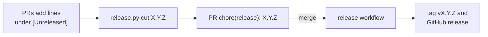

# Releases

A release gives a name to a state of the API: the number in `pyproject.toml`, its section in
`CHANGELOG.md`, the git tag `vX.Y.Z` and a GitHub release with that section as its notes. One
command cuts it and the `release` workflow publishes it when its PR is merged. The base cuts
none: it stays at `0.1.0`, and this is the system of the project started from it
(`docs/architecture.md`, "Starting a project from this base").

## How it works

A version goes from the lines its PRs wrote to a published tag in one more PR:



- **One version, in one place.** `version` in `pyproject.toml`. The installed package carries it,
  `APP_VERSION` reads it from there (`docs/configuration.md`), and it shows in the OpenAPI
  document and in the startup summary.
- **The history is written by hand.** Each PR that changes behavior adds its line under
  `## [Unreleased]`. Cutting a release moves those lines under `## [X.Y.Z] - <date>` and leaves
  an empty `[Unreleased]` above; nothing is generated from commit messages.
- **A version is published once it has its section.** On every push to `main` the workflow asks
  `release.py pending`: the version of `pyproject.toml`, if `CHANGELOG.md` has its section. When
  there is one and no tag `vX.Y.Z` carries it, the workflow creates the tag on that commit and
  the release. A push that cut no version publishes nothing.

### What the numbers say

Versions follow [Semantic Versioning](https://semver.org/), read from where a client of the API
stands:

| Raise | When | For example |
|---|---|---|
| major | A client has to change to keep working | A route or a field removed or renamed, another status or error `code` for the same case |
| minor | A client can do something it could not | A new route, a new optional field or filter |
| patch | The API does again what it said | A bug fix, a dependency update |

Under `1.0.0` nothing is promised yet: a change that breaks a client raises the minor.

A release that asks something of who deploys it (a new required setting, a migration that needs
a quiet moment) says so in its line of the changelog.

The `/v1` of the paths is not this number. It names the contract clients are written against,
and many versions serve it; the version names what is deployed.

## Usage

```bash
# 1. On a branch, cut the version: writes pyproject.toml, uv.lock and CHANGELOG.md
git checkout -b chore/release-0.2.0
uv run python scripts/release.py cut 0.2.0

# 2. Its PR; merging it publishes v0.2.0
git commit -am "chore(release): 0.2.0"
git push -u origin chore/release-0.2.0
gh pr create --title "chore(release): 0.2.0" --body "Release 0.2.0."
```

The first release of a project keeps the version it started with: `cut 0.1.0` changes only the
changelog.

`cut` writes nothing and says why when the version is not three numbers (`1.2.3`), is lower than
the current one, already has its section, or when there is no line under `[Unreleased]`.

Two more commands, the ones the workflow runs:

```bash
uv run python scripts/release.py pending      # the version waiting to be published, or nothing
uv run python scripts/release.py notes 0.2.0  # the section of that version
```

### Shipping more than the tag

The workflow ends where the delivery of each project starts: the image in a registry, a
deployment. They go in the same job, as steps after "Tag and release" with its `if`. A separate
workflow listening to the tag or to the release would not start: GitHub starts none for what
the workflow token creates.

## Guarantees and limits

- `pyproject.toml` and `CHANGELOG.md` cannot drift apart: `tests/unit/test_release.py` fails when
  a version is raised by hand, a section is written by hand, a heading is not
  `## [X.Y.Z] - YYYY-MM-DD` or the versions are not newest first.
- The tag is on the commit that brought the version to `main`. Nobody pushes it by hand, so it
  cannot name another commit or another number.
- Publishing happens once: a later push, or the same run again, finds the tag and does nothing.
- What is published reached `main` through a PR whose checks passed; the workflow does not wait
  for the CI run of the push.
- The workflow needs no secret: it uses the workflow token, with write access to the repository
  contents in this one job.
- One line of versions, cut from `main`: no pre-releases (`1.0.0rc1` is refused) and no
  maintenance branch for an older version.
- Between two releases every build reports the last one: the version does not tell which commit
  is running.
- A tag deleted by hand is created again by the next push, on that later commit. To take a
  version back, cut the next one.

## Files

| File | Role |
|---|---|
| `scripts/release.py` | `cut`, `pending` and `notes` |
| `.github/workflows/release.yml` | Publishes the pending version on a push to `main` |
| `pyproject.toml`, `uv.lock`, `CHANGELOG.md` | What a cut writes |
| `tests/unit/test_release.py` | The rules of a cut; the changelog and `pyproject.toml` agree |
| `tests/functional/test_release_script.py` | The script run with the real `uv` |
