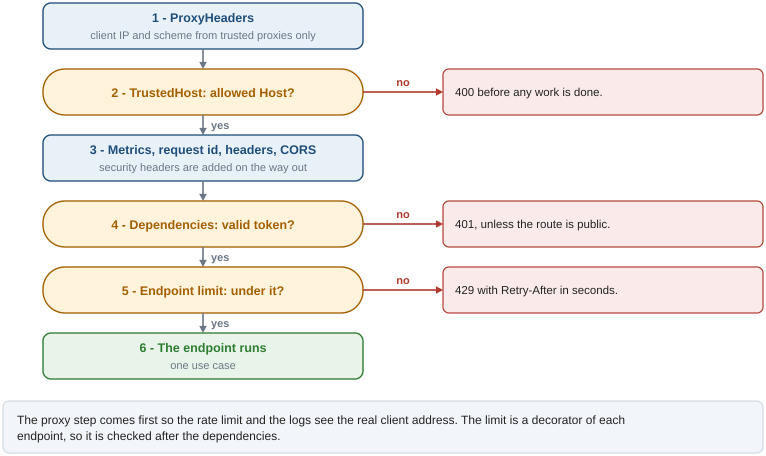

# HTTP security

The middleware stack and per-endpoint guards that every request goes through: trusted proxies
and hosts, security headers, CORS, authentication and rate limits.

## How it works

`app/core/middleware.py` registers, from outermost to innermost: `ProxyHeadersMiddleware`,
`TrustedHostMiddleware`, metrics, request id, `SlowAPIMiddleware`, `SecurityHeadersMiddleware`,
CORS, GZip and `UnhandledErrorMiddleware` (`docs/errors.md`). The order is checked by
`tests/unit/core/test_register_middleware.py`.

- **Proxies.** `X-Forwarded-For` and `X-Forwarded-Proto` are honored only from the addresses in
  `FORWARDED_ALLOW_IPS`, so the client IP seen by the rate limiter and the logs cannot be forged.
- **Hosts.** A `Host` header not in `ALLOWED_HOSTS` gets 400.
- **Headers.** Every response gets `Content-Security-Policy: default-src 'none';
  frame-ancestors 'none'; base-uri 'none'; form-action 'none'`, `X-Content-Type-Options: nosniff`,
  `X-Frame-Options: DENY`, `Referrer-Policy: no-referrer`, a restrictive `Permissions-Policy`,
  and `Strict-Transport-Security` when `HSTS_ENABLED`. `/docs`, `/redoc` and `/openapi.json` skip
  the CSP (Swagger UI loads scripts from a CDN). Headers the app already set are kept.
- **CORS.** Credentials allowed for `ALLOWED_ORIGINS`; methods GET, POST, PUT, PATCH, DELETE,
  OPTIONS; headers `Authorization`, `Content-Type`, `X-Request-ID`; `X-Request-ID` exposed.
- **Authentication.** Endpoints depend on `CurrentUser`, directly or through a permission guard
  (`docs/auth.md`). A valid token says who is calling, nothing more.
- **Authorization**, at two levels. The route requires a permission
  (`require_permissions(permission="items:write")`, 403 `forbidden` without it): whether this user
  may do this kind of thing at all. The use case decides on which resources: the ones the user
  owns, unless it holds the `<context>:manage` permission. Someone else's resource answers 404,
  like an id that does not exist, so the response does not confirm it is there
  (`app/items/services/access.py`). Lists are limited to the owner in the query itself.
- **Rate limits.** Each endpoint declares `@limiter.limit(...)`: `RATE_LIMIT_STRICT` on login,
  register and refresh, `RATE_LIMIT_DEFAULT` on the rest. It is checked when the endpoint is
  called, after its dependencies, so a request with an invalid token gets 401 and does not count.

## Usage

- A new endpoint gets three things: a permission guard as its user dependency (see
  `Reader`/`Writer`/`Deleter` in `app/items/api/router.py`), an ownership check in its use case
  for anything addressed by id, and `@limiter.limit(settings.RATE_LIMIT_DEFAULT)` (with a
  `request: Request` parameter, which slowapi needs). `CurrentUser` alone is for routes about the
  caller itself, such as `/auth/me`.
- A new kind of resource is added to `RESOURCES` in `tests/integration/api/test_authorization.py`
  (how to create one), and every route that names it is then requested by a second user.
- A new permission is reference data: a migration inserts it and grants it to the roles
  (`migrations/versions/0004_items_permissions.py`).
- A public endpoint is added to `PUBLIC` in `tests/functional/test_auth_required_on_all_endpoints.py`
  with the reason; an endpoint without a limit, to `EXEMPT` in
  `tests/unit/test_every_endpoint_has_a_rate_limit.py`.
- Behind a reverse proxy that already adds the security headers, set
  `SECURITY_HEADERS_ENABLED=false`.

## Configuration

| Setting | Default | Outside local |
|---|---|---|
| `FORWARDED_ALLOW_IPS` | `127.0.0.1` | Proxy address or subnet; `*` aborts startup |
| `ALLOWED_HOSTS` | `["*"]` | Explicit host names; `*` or empty aborts startup |
| `ALLOWED_ORIGINS` | localhost frontends | Explicit origins; `*` or empty aborts startup |
| `SECURITY_HEADERS_ENABLED` | `true` | |
| `HSTS_ENABLED`, `HSTS_MAX_AGE` | `false`, `31536000` | Enable behind HTTPS |
| `RATE_LIMIT_ENABLED` | `true` | |
| `RATE_LIMIT_STRICT`, `RATE_LIMIT_DEFAULT` | `5/minute`, `60/minute` | |

## Guarantees and limits

- Every route answers 401 without a token, and to a token that is not valid, unless listed in
  `PUBLIC`; every endpoint has a limit unless listed in `EXEMPT`. Both are checked by tests that
  walk the whole API.
- Every route with a path parameter answers 403 or 404 to a user who does not own the resource:
  `tests/integration/api/test_authorization.py` walks them against a real database and fails for
  a route whose resource it does not know how to create.
- Rate limit counters are in memory per process: with `--workers N` the effective limit is `N`
  times the configured one, and they reset on restart. A shared limit needs a Redis or memcached
  storage for slowapi.
- Related safeguards: `SECRET_KEY` and UTC checks at startup (`docs/configuration.md`), no SQL
  built from strings (`tests/unit/test_no_interpolated_sql.py`), dependency audit
  (`docs/tooling.md`).

## Files

| File | Role |
|---|---|
| `app/core/middleware.py` | Stack and order |
| `app/core/security/headers.py` | `SecurityHeadersMiddleware` |
| `app/core/ratelimit.py` | `limiter` |
| `app/core/config.py` | Settings and their validators |
