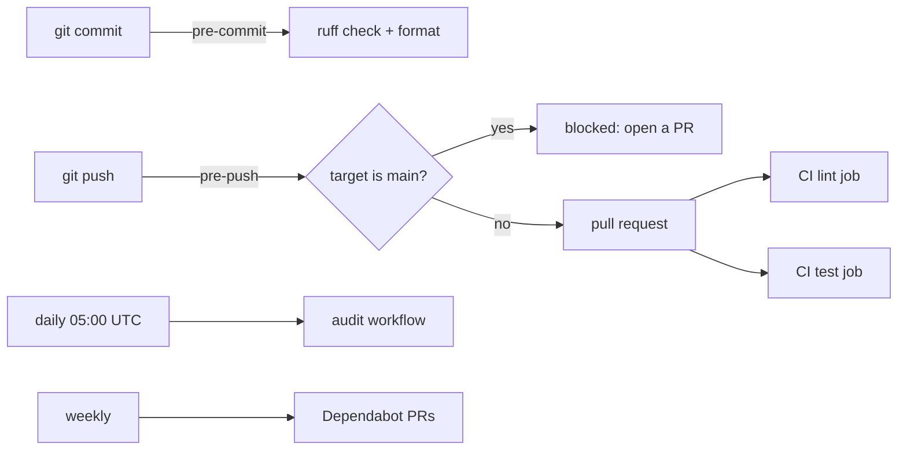

# Tooling and CI

## What it solves

The same checks run on every change, in the same order, locally and in CI: lint, format, types,
generated diagrams, known vulnerabilities, the Dockerfile and the tests. A PR merges only when all
of them pass.

## What runs where

| Where | What |
|---|---|
| `pre-commit` hook | `ruff check` and `ruff format --check` on staged Python files |
| `pre-push` hook | Blocks direct pushes to `main` (`git push --no-verify` to bypass once) |
| CI `lint` job | `uv lock --check`, ruff, mypy, diagrams up to date, pip-audit (warning only), hadolint |
| CI `test` job | The whole suite (unit, functional, integration with testcontainers) with coverage >= 80% |
| `audit` workflow | pip-audit on the full dependency tree, daily; this one fails |
| Dependabot | `uv`, GitHub Actions and the Docker base image, weekly and grouped |

Install both hooks with `bash scripts/install-hooks.sh`. Run what CI runs with
`bash scripts/ci-local.sh` (`SKIP_INTEGRATION=1` without Docker).

## Lint rules worth knowing

Ruff runs with `E W F I N UP B BLE SIM TCH G S TID251`:

- **`BLE` (blind except).** An `except Exception` must re-raise or log the traceback
  (`exc_info=True`, `logger.exception`). When swallowing it is intended, the `noqa: BLE001`
  carries the reason next to it.
- **`S` (bandit).** Security smells. Test files may use `assert` and literal passwords.
- **`TID251`.** `fastapi.testclient` and `starlette.testclient` are banned: tests use
  `httpx.AsyncClient` with `ASGITransport`, which runs in the test's own event loop.
- **SQLAlchemy exceptions.** `UP037`, `F821` and `TC001`-`TC003` are ignored: the ORM resolves
  `Mapped[...]` annotations at runtime, so they cannot be quoted or moved under `TYPE_CHECKING`.
- `.claude/` (vendored skills) is excluded, with `force-exclude` so the pre-commit hook, which
  passes file names, honors it too.

## Types

`mypy app/ main.py` runs with `disallow_untyped_defs`, `warn_return_any` and the pydantic plugin.
Tests and FastAPI routers (`app/api/*`) may omit annotations. A `type: ignore` needs its error
code and, if not obvious, a comment.

## Warnings

pytest turns `DeprecationWarning` raised from `app` or `tests` into errors and ignores the ones
from third-party packages. The ignore entry comes first on purpose: pytest applies the last
filter that matches.

## Diagrams

The SVGs in `docs/img/` are generated by `docs/img/<topic>.py` with the `esquemas-svg` skill.
CI runs every generator and fails if an SVG changes, so edit the script, regenerate and commit
both.

## Dependencies

- Add or bump with `uv add <package>` / `uv lock --upgrade-package <package>`; commit `uv.lock`.
- CI fails if `uv.lock` is out of date with `pyproject.toml`.
- Security updates from Dependabot arrive in a single grouped PR.
