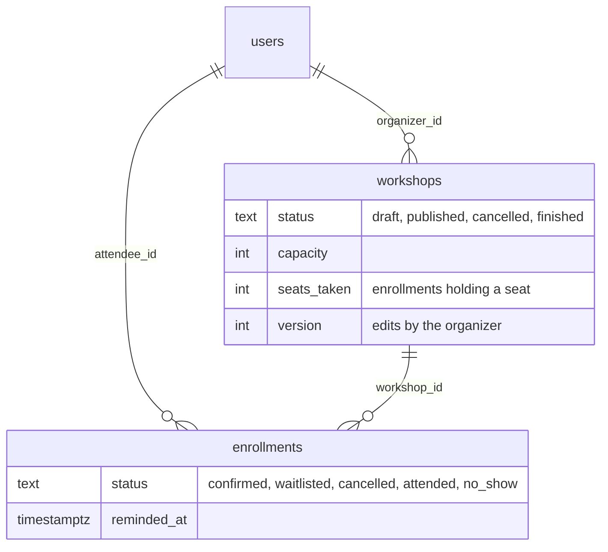
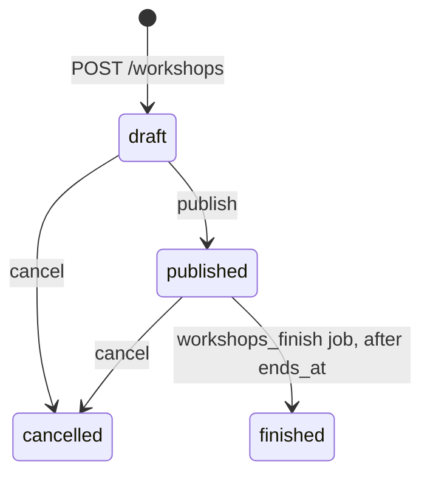
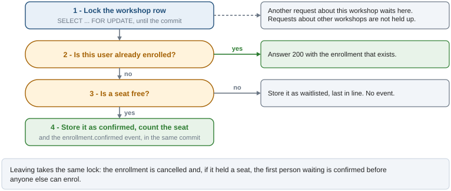

# Workshops: the example context

`app/workshops` is the example that comes with the boilerplate: workshops with a limited
number of seats, people who enrol, and a waiting list. It is small enough to read in one
sitting and each piece of the infrastructure has a job in it: permissions and ownership, both
paginations, a state machine, a multi-row transaction under a lock, events, jobs. A project that
starts here replaces it with its own contexts (`docs/architecture.md`, "Replacing the example
context").

## How it works

Two tables on top of `users`. A user of another context is referenced by id, without an ORM
relationship (`docs/adr/003-bounded-contexts.md`); an enrollment and its workshop are in the
same context and are joined.



A workshop moves through four states. Only its organizer sees it while it is a draft; nothing
leaves `cancelled` or `finished`.



**Seats.** `seats_taken` equals the number of enrollments that hold a seat (`confirmed`, and
`attended` or `no_show` once attendance is recorded), never exceeds `capacity`, and nobody waits
while a seat is free. Every request that could break that (enrolling, leaving,
changing the capacity, cancelling) first locks the row of its workshop, so requests about the
same workshop run one after another.



A counter updated with `UPDATE ... SET seats_taken = seats_taken + 1 WHERE seats_taken <
capacity` would protect the count and not the waiting list: a request that frees a seat does not
see a person who is being added to the list at that moment, and the seat stays free. The lock
closes that gap, and it is part of the types: the seat rules take a `LockedWorkshop`, which only
`WorkshopRepo.get_for_update` returns, so mypy rejects a workshop read without it.

**Events and jobs.** A change that concerns an attendee leaves an event in the outbox, in the
same transaction as the change; the handlers deliver it to `WEBHOOK_URL` with the event id as
`Idempotency-Key` and raise unless the receiver accepted it: `WebhookRejectedError` or
`WebhookUnreachableError`, which name the status or the transport error and never the URL
(`docs/event-bus.md`).

| Event | Published when |
|---|---|
| `enrollment.confirmed` | Someone enrols and gets a seat |
| `enrollment.promoted` | A seat is freed, or the capacity grows, and the next person waiting gets it |
| `enrollment.cancelled` | Someone leaves (`reason: left`), or the workshop is cancelled (`workshop_cancelled`, one event per person) |
| `enrollment.reminder` | The `workshop_reminders` job, once per confirmed attendee, in the day before the start |

| Job | Every | Does |
|---|---|---|
| `workshop_reminders` | 15 min | Marks the confirmed enrollments of workshops that start within 24 hours and publishes their reminder, at most 500 per run |
| `workshops_finish` | 5 min | Moves published workshops past `ends_at` to `finished` |

## Usage

Every route requires a permission (403 without it), and the use case then decides on which
workshops (`docs/security.md`). The `user` role holds `workshops:read`, `workshops:create` and
`workshops:enroll`; `admin` also holds `workshops:moderate`, which sees and runs the workshops of
every organizer.

| Route | Permission | Who, and what it answers |
|---|---|---|
| `POST /v1/workshops` | `create` | Anyone with the permission; the new workshop is a draft |
| `GET /v1/workshops` | `read` | By cursor, ordered by `starts_at`. What was published, plus the caller's drafts. Filters `status`, `starts_after`, `q` |
| `GET /v1/workshops/{id}` | `read` | 404 for someone else's draft |
| `PATCH /v1/workshops/{id}` | `create` | The organizer. Needs the `version` last read: 409 `version_conflict` otherwise. 409 `capacity_below_enrolled` |
| `POST /v1/workshops/{id}/publish`, `/cancel` | `create` | The organizer. 409 `invalid_state` outside the diagram |
| `POST /v1/workshops/{id}/enrollments` | `enroll` | The caller enrols: 201 `confirmed` or `waitlisted`; 200 if already enrolled. 409 `enrollment_closed` |
| `DELETE /v1/workshops/{id}/enrollments/me` | `enroll` | The caller leaves: 204; 404 without an enrollment |
| `GET /v1/workshops/{id}/enrollments` | `create` | The organizer, by page, in the order people enrolled |
| `POST /v1/workshops/{id}/enrollments/{eid}/attendance` | `create` | The organizer, once it started. 404 for an enrollment of another workshop |
| `GET /v1/me/enrollments` | `enroll` | The caller's enrollments, newest first, each with its workshop |

A workshop someone else organizes is public once published, so the routes of its organizer
answer 403 to anyone else; while it is a draft they answer 404, like an id that does not exist.

```bash
TOKEN=...   # access_token of POST /v1/auth/login
curl -X POST localhost:8000/v1/workshops -H "Authorization: Bearer $TOKEN" -H "Content-Type: application/json" \
  -d '{"title": "Intro to pottery", "starts_at": "2030-05-04T10:00:00Z", "ends_at": "2030-05-04T12:00:00Z", "capacity": 8}'
curl -X POST localhost:8000/v1/workshops/1/publish -H "Authorization: Bearer $TOKEN"
curl -X POST localhost:8000/v1/workshops/1/enrollments -H "Authorization: Bearer $TOKEN"
```

`uv run python scripts/seed_dev.py` creates a few workshops in each state for the local admin.

## Guarantees and limits

- **Seats are never overbooked and never left free with people waiting**, with any number of
  API processes: the lock is in PostgreSQL. CHECK constraints (`seats_taken` within `capacity`,
  known statuses, `ends_at` after `starts_at`) refuse an impossible row whatever the code does,
  and a partial unique index allows one enrollment per user and workshop that is not cancelled.
- **Enrolling is idempotent**: a repeated request returns the same enrollment.
- **A change and its events are stored together or not at all.** Delivery is at least once and
  in no particular order (`docs/event-bus.md`).
- **Requests about one workshop wait for each other**, for the few milliseconds each takes;
  reading and listing never wait. A request that cannot get the lock within `DB_LOCK_TIMEOUT_MS`
  answers 503 `busy` with `Retry-After` (`docs/errors.md`).
- **Cancelling writes one event per person enrolled or waiting**, in one batch inside the
  request: the size of that transaction grows with the number of people.
- An attendee is an id: names and emails belong to `auth`, and no route of this context exposes
  them.
- Enrolling and leaving close when the workshop starts. Nothing checks that a workshop is
  created or published before it starts.

## Files

| File | Role |
|---|---|
| `app/workshops/models/` | `WorkshopORM`, `EnrollmentORM`, their constraints and indexes |
| `app/workshops/repos/` | Queries: visibility scope, `get_for_update`, waiting list, due reminders |
| `app/workshops/services/access.py` | Who sees and who runs a workshop |
| `app/workshops/services/lifecycle.py` | The states and what each allows |
| `app/workshops/services/seating.py` | Seats and the waiting list, under the lock |
| `app/workshops/use_cases/` | One per route, plus the reminders batch |
| `app/workshops/api/router.py` | Routes, permission guards, declared errors |
| `app/workshops/event_handlers/notifications.py` | Webhook delivery of the four events |
| `app/workshops/jobs/` | `workshop_reminders`, `workshops_finish` |
| `app/workshops/exceptions.py` | The 409 codes of the rules |
| `migrations/versions/0008_workshops.py` | Tables, permissions and job rows |
| `tests/integration/api/test_workshop_concurrency.py` | The invariants under simultaneous requests |
